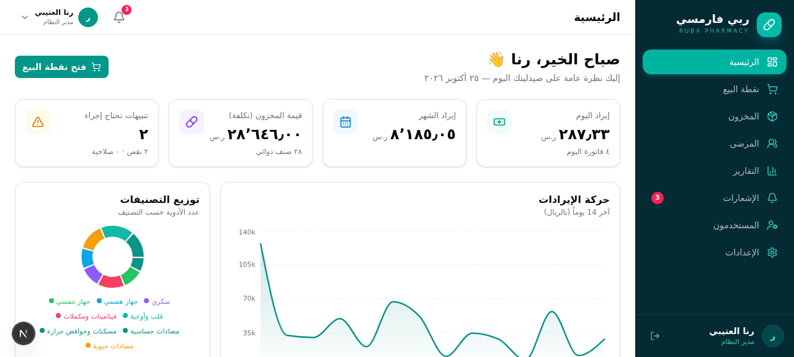
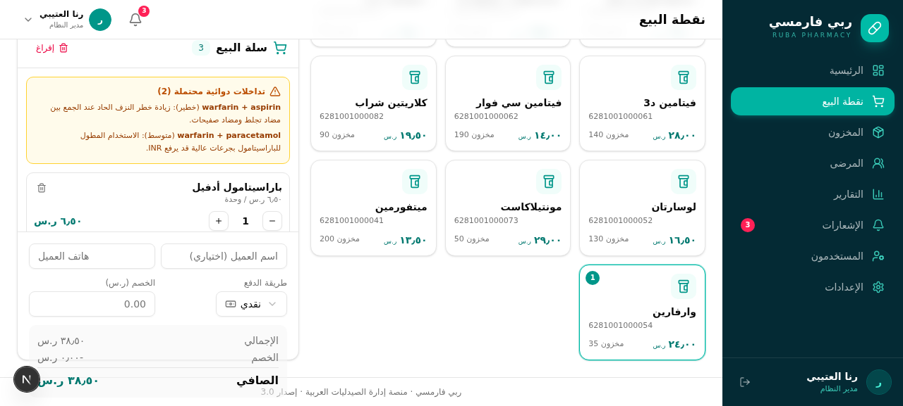
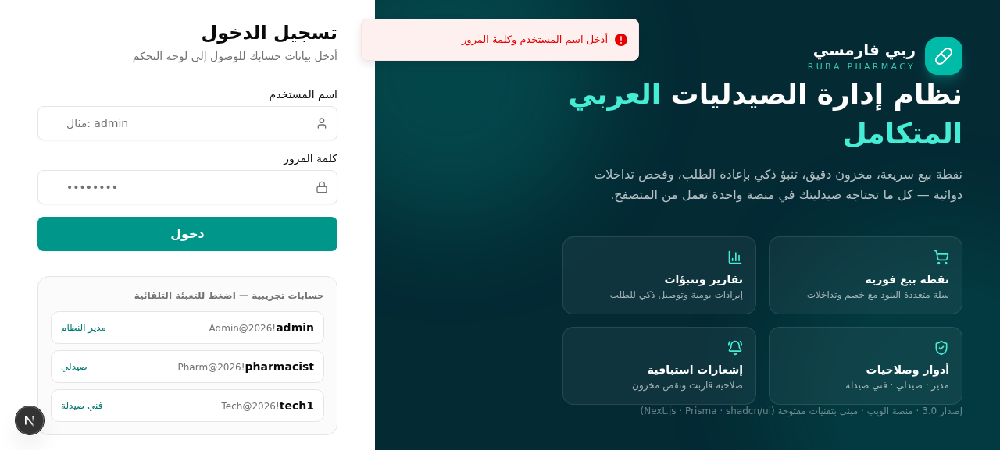

<div dir="rtl" align="center">

# 💊 ربي فارمسي — نظام إدارة الصيدليات العربي المتكامل

**منصة ويب حديثة «بمستوى الكبار» لإدارة الصيدلية بالكامل: نقطة بيع ذكية، مخزون، مرضى، تداخلات دوائية، تقارير — بواجهة عربية RTL أنيقة.**


</div>

---

<div dir="rtl">

## 📸 نظرة سريعة

| لوحة التحكم | نقطة البيع الذكية |
|:---:|:---:|
|  |  |

| تسجيل الدخول | تحذيرات التداخلات الدوائية الحية |
|:---:|:---:|
|  | تحذير فوري عند الجمع بين **وارفارين + أسبرين** (خطر نزف) مباشرة في سلة البيع |

## ✨ المزايا

### 🛒 نقطة البيع (POS)
- سلة بيع تفاعلية مع بحث فوري بالاسم أو الباركود
- **فاحص تداخلات دوائية حي**: يفحص سلة↔سلة وسلة↔أمراض المريض المزمنة قبل إتمام البيع
- خصومات، طرق دفع متعددة (نقدي/شبكة)، فاتورة رقمية بعد البيع
- **Idempotency**: مرجع فريد لكل عملية يمنع البيع المكرر عند ضعف الشبكة
- إلغاء واسترجاع كامل للفواتير مع إعادة الكميات تلقائياً

### 📦 المخزون والتنبؤ
- إدارة كاملة للأدوية (28 دواء عربي مُحمَّل جاهزاً) مع التصنيفات
- **دفعات التشغيلة (LOT)** بصلاحية مستقلة + **صرف FEFO** آلي: الأقرب انتهاءً يُصرف أولاً، والمنتهي محجوب حتى لو ظهر الرصيد متاحاً
- سجل تدقيق **StockMovement** لكل حركة إدخال/إخراج — لا رقم يختفي
- **تنبؤ إعادة الطلب** الذكي بناءً على معدل الاستهلاك اليومي ومهلة التوريد
- تنبيهات انخفاض المخزون ونفاد الأصناف عبر مركز إشعارات بمفتاح `dedupeKey` فريد

### 👥 المرضى والرعاية
- ملفات مرضى مع الأمراض المزمنة والحساسية
- فحص التداخلات مرتبط بسجل المريض المزمن — سلامة دوائية حقيقية

### 📊 التقارير والذكاء
- لوحة تحكم بمؤشرات KPI حية: مبيعات اليوم، إيراد الشهر، قيمة المخزون، تنبيهات
- رسوم بيانية (Recharts): حركة الإيرادات اليومية + توزيع التصنيفات
- تقارير مبيعات بفلاتر تاريخ وحالة، **تصدير CSV** بترميز UTF-8-BOM يفتح مباشرة في Excel العربي

### 🔐 الأمان — مراجعة هندسية حقيقية
هذه النسخة نتجت عن **مراجعة أمنية شاملة** أصلحت أبرز ثغرات الأنظمة المشابهة:

| الثغرة | الإصلاح |
|---|---|
| فحص الدور داخل الـ handler بعد اجتياز DRF (يتجاوزه الفني) | فحص دور مركزي في **كل** endpoint قبل التنفيذ — `403` للفني على التعبئة |
| تضارب أنواع الكميات (Decimal مقابل Int) | النقود بالهللات (Integer) — دقة مالية مطلقة، بلا أخطاء فاصلة عائمة |
| دمج الإشعارات عبر `title__contains` الهش | مفتاح `dedupeKey` فريد لكل تنبيه |
| فحص التداخلات غير مربوط بنقطة البيع | فحص إلزامي في سلة البيع قبل الاعتماد |
| كلمات مرور؟ | `bcrypt` + JWT (jose) في كوكي `httpOnly` — لا توكن في localStorage |

## 🧱 التقنيات

- **Next.js 16** (App Router) + **TypeScript 5**
- **Prisma 6** + SQLite (جاهز للترقية إلى PostgreSQL بتغيير واحد)
- **Tailwind CSS 4** + **shadcn/ui** + **Recharts** + وضع ليلي
- خط **Tajawal** العربي، ثيم طبي Teal، دعم RTL كامل
- **اختبارات وحدوية** (Vitest — `bun run test`) تغطي المال وFEFO والأدوار
- **PWA جاهز للتثبيت والنشر على Google Play** (TWA) — راجع [docs/ANDROID.md](docs/ANDROID.md)
- **Docker** متعدد المراحل + `docker-compose` للتشغيل الفوري داخل الصيدلية
- **CI/CD**: فحص lint + بناء إنتاج في كل دفعة، وDependabot أسبوعي للتبعيات
- اختبار تحقّق كامل عبر متصفح آلي (دخول ← بيع ← تداخل دوائي ← تقارير ← جوال 390px)

## 🏢 حوكمة بمعايير الشركات

| الوثيقة | الغرض |
|---|---|
| [SECURITY.md](SECURITY.md) | سياسة الإبلاغ عن الثغرات + ملخص التعزيز الأمني |
| [CONTRIBUTING.md](CONTRIBUTING.md) | دليل المساهمة ومعايير الكود |
| [CHANGELOG.md](CHANGELOG.md) | سجل الإصدارات منذ 1.0 |
| [docs/EVALUATION.md](docs/EVALUATION.md) | **التقييم المقارن** مع Odoo/ERPNext/GNU Health وخارطة المعالجة |
| [docs/DEPLOYMENT.md](docs/DEPLOYMENT.md) | نشر Vercel / Docker / PostgreSQL |
| [docs/ANDROID.md](docs/ANDROID.md) | خطوات النشر على Google Play خطوة بخطوة |
| [docs/PRIVACY_POLICY.md](docs/PRIVACY_POLICY.md) | سياسة خصوصية جاهزة متوافقة مع متطلبات Play |

## 🐳 تشغيل بأمر واحد

```bash
docker compose up -d --build   # المنصة على http://localhost:3000
```

## 🚀 التشغيل السريع

```bash
# 1) الاستنساخ
git clone https://github.com/<YOUR-USERNAME>/ruba-pharmacy.git
cd ruba-pharmacy

# 2) التبعيات
bun install        # أو: npm install / pnpm install

# 3) البيئة
cp .env.example .env

# 4) قاعدة البيانات + بيانات تجريبية غنية
bun run db:push
bun run scripts/seed.ts

# 5) التشغيل
bun run dev        # ← http://localhost:3000
```

### 🔑 حسابات تجريبية (بيانات البذرة)

| الدور | المستخدم | كلمة المرور |
|---|---|---|
| مدير النظام | `admin` | `Admin@2026!` |
| صيدلي | `pharmacist` | `Pharm@2026!` |
| فني صيدلة | `tech1` | `Tech@2026!` |

> ⚠️ **للإنتاج**: غيّر كلمات المرور فوراً، واضبط `DATABASE_URL` على PostgreSQL، وشغّل خلف HTTPS.

## 🗂️ بنية المشروع

```
ruba-pharmacy/
├── .github/                    # CI، قوالب Issues/PR، Dependabot
├── prisma/schema.prisma        # 9 نماذج: User, Medicine, Sale, Patient, ...
├── scripts/seed.ts             # بيانات تجريبية عربية واقعية
├── docs/                       # ANDROID، DEPLOYMENT، PRIVACY_POLICY + لقطات
├── src/
│   ├── app/api/                # 11 مسار API: auth, sales, medicines, ...
│   ├── app/manifest.ts         # بيان PWA (تثبيت + Google Play)
│   ├── app/(dashboard)/        # الصفحات: POS، مخزون، مرضى، تقارير...
│   └── components/ruba/        # مكونات المنصة المخصصة
├── Dockerfile                  # صورة إنتاج متعددة المراحل (مستخدم غير جذر + healthcheck)
└── docker-compose.yml          # تشغيل فوري بوحدة بيانات دائمة
```

## 🗺️ خارطة الطريق

- [x] ✅ Docker + CI/CD + PWA + وثائق Google Play
- [x] ✅ دفعات LOT + صرف FEFO + إشعارات دفعات + اختبارات + وضع ليلي (v3.1)
- [ ] موردون وأوامر شراء (Purchase Orders)
- [ ] ماسح باركود بالكاميرا + عمل دون اتصال (Offline PWA)
- [ ] باركود QR للفواتير (ZATCA)

<div align="center">

**ربي فارمسي** — منتج تطويره فريق **Ruba Pharmacy Team** 🇸🇦

</div>

## 📄 الرخصة

MIT — استخدمه، عدّله، انشره بحرية. راجع [LICENSE](LICENSE).

</div>

---

<div align="center">

**Ruba Pharmacy Platform** — An Arabic-first, production-ready pharmacy management system.
POS with live drug-interaction checks · audited inventory · reorder forecasting · RTL UI.

Made with ❤️ for Arabic pharmacies

</div>
